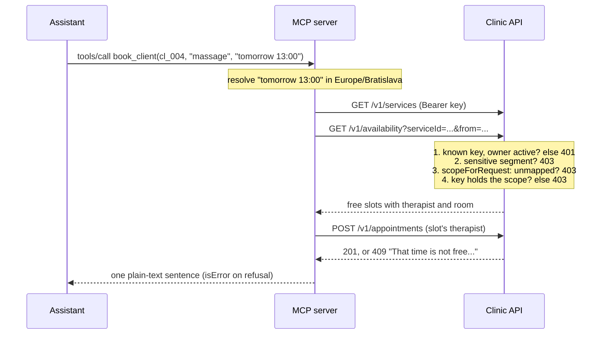

# mcp-api-boundary

A small, working example of an MCP server that lets an assistant do a physiotherapy clinic's front-desk work (find a client, check the day, offer a slot, book, cancel, list unpaid invoices) without ever being able to reach clinical notes, photos or questionnaires. The point is where that guarantee lives. The MCP server here has no data access of its own and no rules of its own: it calls the clinic's public API with a bearer key, and the API decides. The boundary lives in the API, not in the MCP server, and the default answer is no. Everything runs in memory with fictional seed data, so you can clone it, run it and connect Claude Desktop in a few minutes.

## The design

1. **The API derives the required scope from method and path.** `scopeForRequest('POST', '/v1/appointments')` returns `appointments:write`. Anything not in the table returns `null`, and `null` is a 403. A new endpoint is closed until someone opens it on purpose.
2. **Sensitive paths are refused before scopes are checked.** Any request from an API key whose path contains `records`, `notes`, `photos`, `attachments`, `consents` or `surveys` gets a 403, whatever scopes the key holds. The check decodes percent-encoding and ignores case and extensions, so `%72ecords` and `Records.json` are refused too. A mistake in the scope table cannot open them.
3. **Every key belongs to a person.** A key's effective scopes are the intersection of what it was granted and what its owner's role allows today. Demote the owner and the key shrinks. Suspend them and it stops working. Only the SHA-256 hash of a key is stored.
4. **The MCP server is thin.** It has an HTTP client and six tools. If the API would refuse something, the assistant cannot do it, so there is one set of rules instead of two that drift apart.
5. **Tools are shaped like a receptionist's day, not like the API.** `free_slots` looks up the service and asks the availability engine in one call. `book_client` takes a client ID (never a name) and gets the therapist and room from the free slot, so the model never picks them.
6. **Dates and money are handled in code.** "Tomorrow", "Monday" and "2026-11-03 09:00" are resolved in the clinic's timezone with an injected clock. At 23:30 UTC it is already tomorrow in Bratislava, and the tests check exactly that.
7. **Errors are answers.** When the API refuses ("That time is not free for this service", "This key does not have the invoices:read scope"), the tool returns that sentence with `isError: true`, so the model can tell the person what happened and what to try next.

## How a request flows



## Running it

You need Node 20.19 or newer and pnpm.

```sh
pnpm install
pnpm build
DEMO_API_KEY=cbk_local_demo pnpm api
```

The API starts on `http://localhost:8787` with a fictional clinic and one API key for the receptionist. Without `DEMO_API_KEY`, a random key is printed on every start.

Try the boundary by hand:

```sh
curl -H 'authorization: Bearer cbk_local_demo' 'localhost:8787/v1/clients?search=anna'
curl -H 'authorization: Bearer cbk_local_demo' localhost:8787/v1/clients/cl_001/records
# {"error":403,"message":"Clinical data is never available to API keys or assistants."}
```

### Connecting Claude Desktop

Add this to `claude_desktop_config.json` (Settings, Developer, Edit Config), with the absolute path to your clone, and restart Claude Desktop while the API is running:

```json
{
  "mcpServers": {
    "clinic-reception": {
      "command": "node",
      "args": ["/absolute/path/to/mcp-api-boundary/packages/mcp/dist/main.js"],
      "env": {
        "CLINIC_API_URL": "http://localhost:8787",
        "CLINIC_API_KEY": "cbk_local_demo",
        "CLINIC_TIMEZONE": "Europe/Bratislava"
      }
    }
  }
}
```

Then ask something like "Who is booked tomorrow?" or "Find a free sports massage on Friday and book Zuzana Molnár in." For development, `pnpm mcp` runs the server from source with `tsx`.

### Checks

```sh
pnpm typecheck
pnpm lint
pnpm test
```

The end-to-end tests start the API on a random port, connect a real MCP client to the server and call the tools. One of them throws path traversal and encoded segments at the tools and at every sensitive path with a key that holds every scope a key can hold, and checks that nothing clinical comes back.

## Tools

| Tool                 | What it does                                                               | Scopes the key needs                                      |
| -------------------- | -------------------------------------------------------------------------- | --------------------------------------------------------- |
| `find_client`        | Search by name, phone or e-mail; returns the client ID booking needs       | `clients:read`                                            |
| `day_schedule`       | Who is booked on a day ("today", "Monday", a date)                         | `appointments:read`                                       |
| `free_slots`         | Free times for a service over the next 1 to 30 days                        | `catalog:read`, `appointments:read`                       |
| `book_client`        | Book a client by ID; therapist and room come from the free slot            | `catalog:read`, `appointments:read`, `appointments:write` |
| `cancel_appointment` | Cancel by appointment ID; marked destructive, the model is told to confirm | `appointments:write`                                      |
| `unpaid_invoices`    | Unpaid and partly paid invoices, overdue first                             | `invoices:read`                                           |

No tool, and no API key, can get `clinical:read`. It exists only for people signed in to the app.

## Adding an endpoint safely

1. Add the route in `packages/api/src/app.ts`. At this point it answers 403 to everyone, because `scopeForRequest` does not know it.
2. Add one line to `ROUTES` in `packages/api/src/scopes.ts` with the narrowest scope that fits. Match the full path with an anchored pattern and a strict ID character class.
3. If you need a new scope, add it to `SCOPES`, decide which roles get it in `ROLE_SCOPES`, and decide whether keys may hold it at all (`KEY_SCOPES`).
4. If the endpoint touches data that must never reach an assistant, put its path segment in `FORBIDDEN_SEGMENTS`. That rule wins over any scope.
5. Add cases to `scopes.test.ts` for the request that should pass and for the ones that should not (other methods, trailing slash, encoded segments).
6. Only then think about whether the assistant needs a tool for it. Most endpoints do not.

## What is intentionally not here

- **OAuth 2.1.** A remote MCP server in production should not ask people to paste API keys. It should follow the [MCP authorization spec](https://modelcontextprotocol.io/specification/2026-07-28/basic/authorization): protected resource metadata, `401` with `WWW-Authenticate`, PKCE with S256, tokens bound to this server as their audience, and no passing the client's token through to other services. The granted scopes would still be capped by the user's role exactly as keys are here. That flow is what a production deployment adds on top of this repository; the API-side boundary stays the same.
- **Streamable HTTP transport.** Only stdio is implemented. A remote transport belongs together with OAuth.
- **Rate limiting per assistant, and an audit trail** that records whether a person or an assistant made a change.
- **Persistence and multi-tenancy.** The store is an array in memory and there is one clinic. In a real system the double-booking check would be a database constraint, and every query would be scoped to the tenant.

## Background

I wrote up the reasoning behind this design, using a production booking system as the example, in [An MCP server for a booking system: what the assistant must not reach](https://www.pavolrasev.com/blog/mcp-server-booking-system/). This repository is a fresh, generic version of the same idea with nothing taken from that product. More about my work is at [pavolrasev.com](https://www.pavolrasev.com/).

## License

[MIT](LICENSE), copyright Pavol Rašev.
